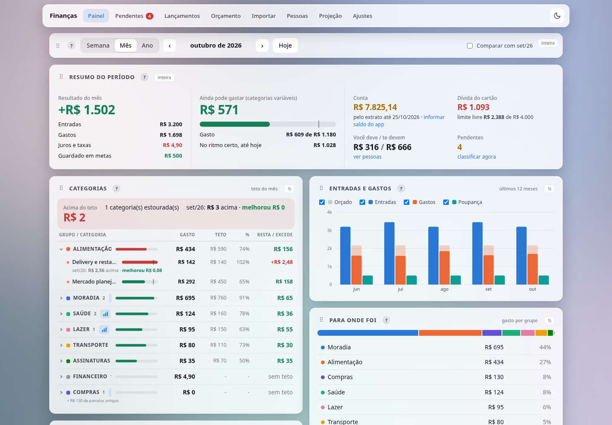
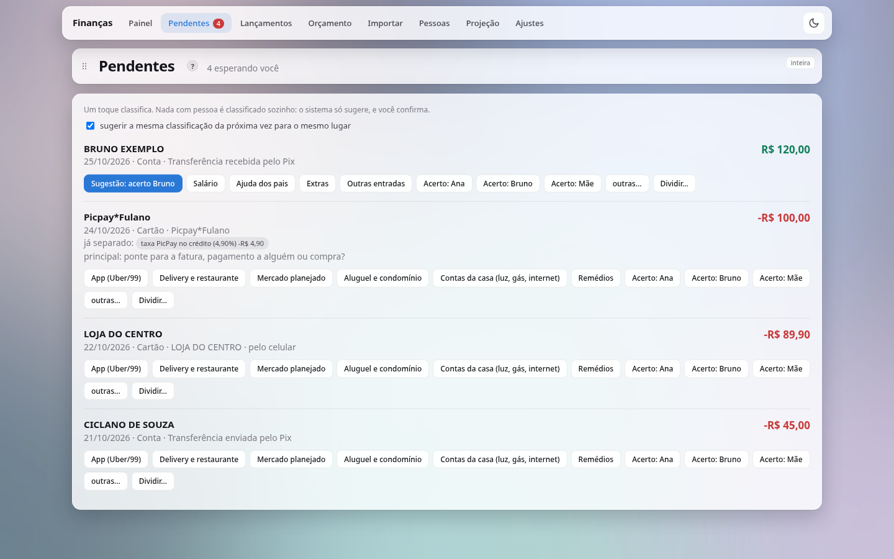
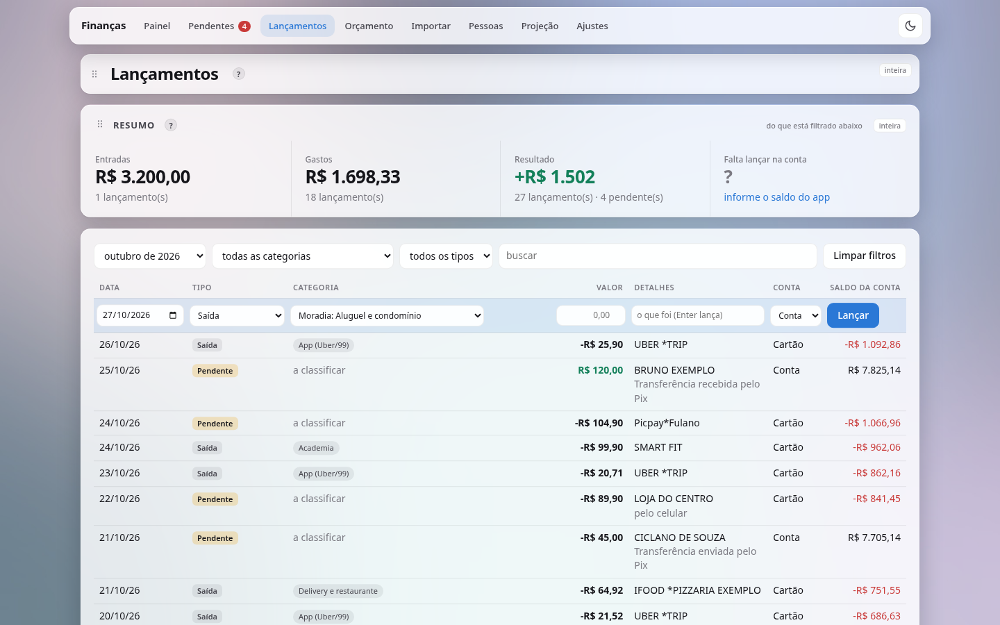
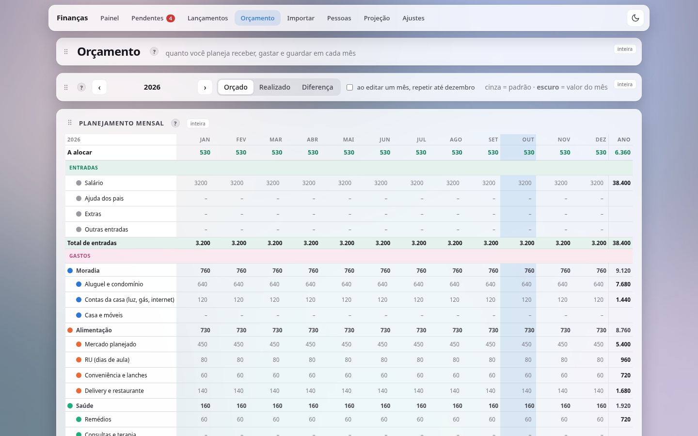
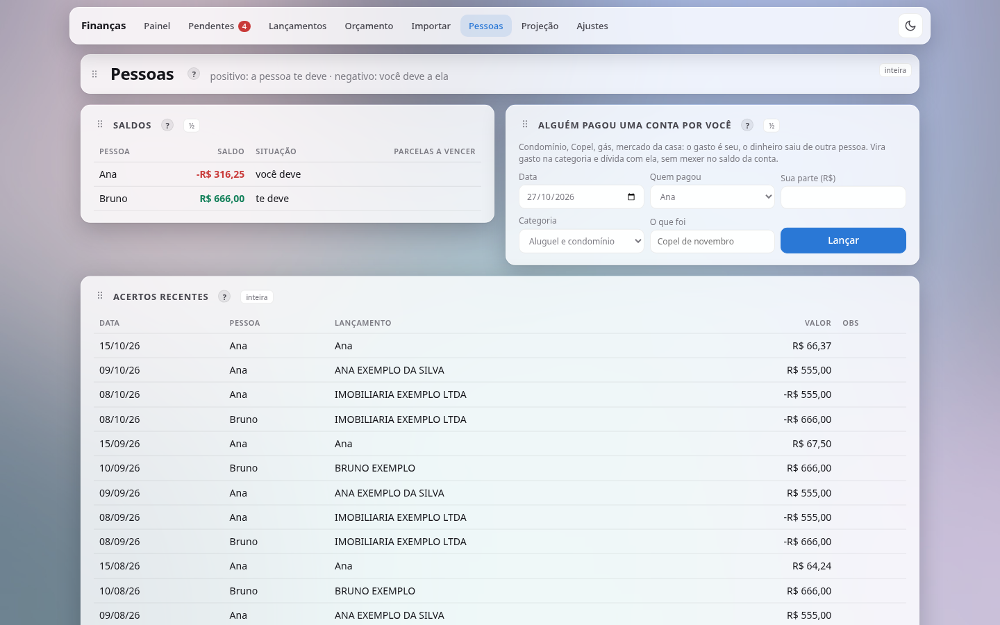
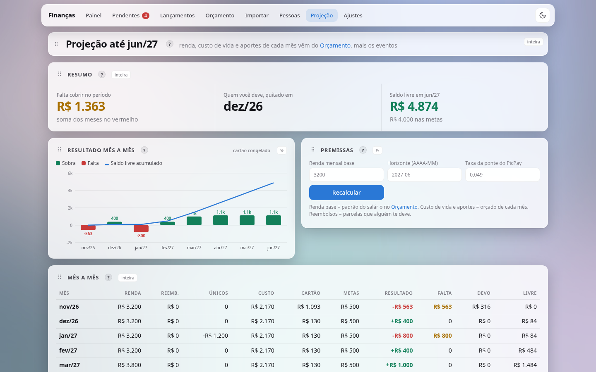
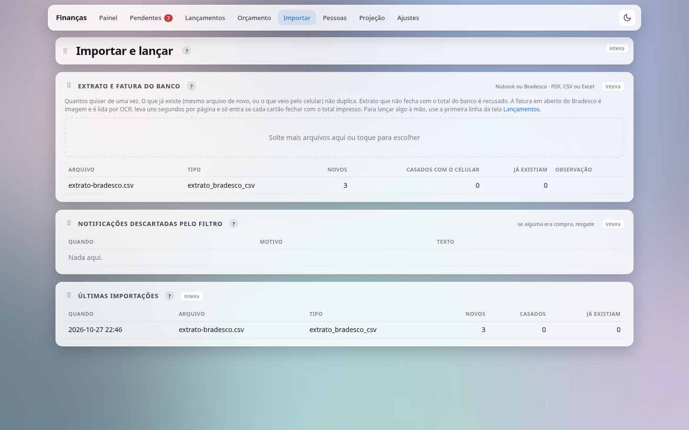
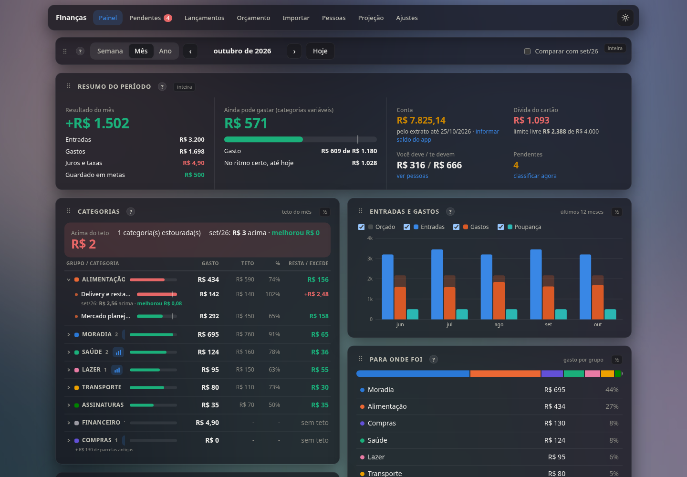

# Finanças

Site para controlar o dinheiro pessoal no lugar da planilha. Importa extrato e fatura do banco, recebe pelo
celular o push que o banco manda a cada compra e divide cada lançamento em partes: gasto, renda,
transferência entre contas suas, acerto com pessoas e poupança em metas. Roda num servidor seu (Docker no
Linux, ou o instalador do Windows) e abre no PC ou no celular. No Android há também um app que funciona
sozinho, sem servidor, e sincroniza quando o servidor está ao alcance.

**Como usar, passo a passo e com exemplos: [docs/GUIA.md](docs/GUIA.md).** Na primeira entrada, um tour
mostra cada tela e cada painel.



Os prints usam um banco de demonstração com pessoas, lugares e valores inventados.

## Telas

| | |
|---|---|
|  |  |
| **Pendentes**: o que o sistema não classifica sozinho, com a sugestão e as categorias a um toque. | **Lançamentos**: filtros, a primeira linha para lançar à mão e o saldo da conta linha a linha. |
|  |  |
| **Orçamento**: categoria por mês (orçado, realizado e diferença) e despesas fixas por item. | **Pessoas**: quem te deve e a quem você deve, contas que alguém pagou por você e os acertos. |
|  |  |
| **Projeção**: mês a mês até o horizonte, com eventos como uma viagem ou uma renda que acaba. | **Importar**: extrato e fatura em .pdf, .csv ou .xlsx; o que já existe não duplica. |

O **Painel** resume semana, mês ou ano: resultado, quanto ainda dá para gastar nas categorias variáveis,
cada categoria contra o teto (e contra o período anterior), entradas e gastos dos últimos 12 meses e para
onde foi o dinheiro. Os cartões se arrastam e se redimensionam. Em **Ajustes** ficam o tema claro ou escuro,
o estilo dos painéis (Vidro, Sólido, Contorno ou Plano), o papel de parede, as pessoas e os dados para o
celular.



## Como o dinheiro é representado

Um **lançamento** é um movimento numa conta (Nubank conta, Nubank cartão, PicPay, Bradesco), com o sinal da
conta. O significado está nas **partes**, que somam o valor do lançamento, cada uma com uma natureza:

| natureza | o que é | exemplo |
|---|---|---|
| gasto | consumo seu, com categoria | mercado, Uber, sua parte do aluguel |
| renda | dinheiro que é seu | salário, ajuda dos pais |
| transferencia | entre contas suas | pagar a fatura, Pix no crédito caindo na conta |
| acerto | alguém te deve ou você deve | a parte de um colega no boleto do aluguel |
| poupanca | dinheiro seu indo para uma meta | aporte na reserva de emergência |

O boleto do aluguel dividido com dois colegas vira a sua parte como gasto mais dois acertos; o Pix de um
deles devolvendo a parte dele é acerto; a conta que um colega pagou por você é um lançamento de valor 0 com
gasto e acerto. Nada de despesa negativa inventada. Lançamento com parte sem categoria (ou acerto sem
pessoa) é **pendente** e o site pergunta.

## Entradas

1. **Celular**: o [app Android](#app-android) lê a notificação do banco e lança na hora no próprio celular,
   e depois sincroniza com o servidor; ou o MacroDroid manda o push para `/api/v1/transaction/webhook` (ver
   [docs/MACRODROID.md](docs/MACRODROID.md)).
2. **Arquivos**, na tela Importar (o tipo é reconhecido pelo conteúdo, não pelo nome):
   - Nubank: extrato e fatura em .pdf ou .csv (`app/importadores.py`).
   - Bradesco (`app/bradesco.py`): extrato em .pdf, .csv ou .xlsx, conferido pelo total e pela corrente
     de saldos; e a fatura em aberto que o aplicativo gera em .pdf, que é só imagem e é lida por OCR
     (tesseract com português, relendo data e valor de cada linha só com dígitos). Cada cartão tem que fechar
     com o "Total para" impresso, senão nada entra. Na primeira importação nascem as contas Bradesco (com o
     saldo anterior ao primeiro lançamento do extrato) e Cartão Bradesco (devendo o saldo anterior da fatura).

   Extrato que não fecha é recusado; o que já existe (mesmo arquivo, outro formato do mesmo extrato, ou o que
   veio pelo celular) não duplica.
3. **À mão**: o que não passa pelo banco.

## Classificação

- **Automático** só o que é verdade por definição: pagamento de fatura saindo da conta, pagamento no cartão
  com o par saindo da conta, Pix no crédito, dinheiro vindo de conta sua (com `TITULAR` no `.env`), a taxa da
  recarga do PicPay no crédito, a parcela seguinte de um parcelamento já classificado e estabelecimento
  conhecido (regras do sistema em `app/categorias.py`).
- **Sugestão**, que fica pendente até você confirmar: Pix de ou para uma pessoa (o mesmo Pix pode ter outra
  finalidade), o boleto da imobiliária dividido pelo rateio de Ajustes, e o que você marcou para sugerir da
  próxima vez no mesmo lugar.

Pendente novo pode gerar um aviso (ver [Avisos](#avisos)).

## Instalação

### No Windows, sem Docker

Para usar no próprio PC (Windows 10 ou 11), sem instalar mais nada:

1. Baixe o `financas-setup-<versão>.exe` (o workflow **Instalador Windows** do GitHub Actions gera o arquivo;
   ele fica nos artefatos de cada execução) e abra.
2. Se o Windows avisar que o programa é de um editor desconhecido, clique em **Mais informações** e
   **Executar assim mesmo** (o instalador não é assinado).
3. Marque o que quiser:
   - **Iniciar o servidor quando o Windows ligar**: o Finanças fica de pé sozinho, sem janela.
   - **Permitir que o celular acesse pela rede local**: necessário para o app do celular sincronizar. O
     Windows pede permissão (a tela de administrador) uma vez, para liberar o firewall.
4. Escolha a senha do site (duas vezes) e, se quiser, o seu nome como o banco escreve no Pix (ex.:
   `FULANO DE TAL`), para o Pix vindo de você mesmo contar como transferência, não como renda.
5. No fim, deixe marcado **Abrir o Finanças agora**. O site abre no navegador em `http://localhost:8095`;
   entre com a senha. Depois, o atalho **Finanças** do Menu Iniciar ou da Área de Trabalho garante o servidor
   de pé e abre o site.

Não é preciso instalar Python, Docker, poppler nem tesseract: tudo vem no instalador, inclusive a leitura de
.pdf e o OCR da fatura do Bradesco. Os dados ficam em `%LOCALAPPDATA%\Financas` (o banco, os papéis de parede,
o `.env` com a senha e as chaves, e o log do servidor em `logs\servidor.log`). O desinstalador (em
Configurações > Aplicativos) para o servidor, tira o início automático e a regra do firewall e pergunta se
apaga os dados. A planilha no modelo antigo (.ods) precisa do LibreOffice e não existe nesta versão: o botão
fica desabilitado com o aviso; a .xlsx funciona. Os avisos de pendente (ver [Avisos](#avisos)) são só do
Linux.

Para gerar o instalador: o workflow `.github/workflows/windows.yml` roda num runner Windows (o PyInstaller
não gera executável de Windows fora dele), junta o poppler e o tesseract com português, compila com o Inno
Setup (`windows/financas.iss`) e testa a instalação silenciosa, o servidor, o OCR e a desinstalação.

### No Linux, com Docker

```sh
git clone https://github.com/bbarrosdavi/financas.git
cd financas
cp .env.example .env        # API_KEY e SESSION_SECRET: openssl rand -hex 32; WEB_PASSWORD: a senha do site
mkdir -p ~/.local/share/financas ~/.local/state/financas/avisos
UID_HOST=$(id -u) docker compose up -d --build
```

O site abre em `http://localhost:8095`. O banco (SQLite) e os papéis de parede ficam em
`~/.local/share/financas`. Para o celular chegar ao site, publique a porta no IP de uma VPN ou da rede de
casa (`PORTA` no `.env`) e ponha em `URL_PUBLICA` o endereço que o celular usa. Não exponha o site direto na
internet.

Fora do Docker, com Python 3.12 ou mais novo: ler .pdf precisa do `pdftotext`/`pdftoppm` (poppler) e a fatura
do Bradesco precisa do `tesseract` com português (`tesseract-ocr-por`). No `.env`, aponte `DATABASE_PATH` e
`PAPEIS_DIR` para pastas suas e rode:

```sh
pip install -r requirements.txt
uvicorn app.main:app --port 8095
```

Testes:

```sh
pip install -r requirements.txt -r requirements-dev.txt
python -m pytest -q
```

## App Android

Um .apk (`financas-<versão>.apk`) que faz o papel do MacroDroid e do site no celular, sem depender do
computador:

- Telas próprias do Android (Kotlin e Jetpack Compose), feitas para a tela do celular: cinco abas embaixo
  (Painel, Pendentes, Lançamentos, Orçamento e Mais, com Importar, Pessoas, Projeção e Ajustes), filtros e
  formulários que cabem sem rolagem para o lado, claro e escuro, e o mesmo tour do site. As telas usam a mesma
  API do site, servida pelo Python que roda no celular, então os números são os mesmos. O banco fica no
  celular e o app abre, lista, lança e classifica sem servidor nenhum.
- Ficam só no site: papel de parede, as opções de Visualização (densidade, fonte, painéis, ordem das abas),
  a comparação com o período anterior e a planilha no modelo antigo (.ods). A .xlsx sai no app também.
- Lê as notificações dos apps de banco escolhidos (por padrão Nubank, PicPay, Mercado Pago e Bradesco) e lança
  na hora, na ordem em que chegam, pelo mesmo leitor do servidor (`app/push_parser.py`, rodando no celular).
- Quando alcança o servidor (na mesma rede ou pela VPN), sincroniza em segundo plano: a cada 15 minutos, ao
  abrir e ao sair do app e depois de cada compra. Sem servidor, nada muda no uso; a próxima sincronização
  leva tudo.

Instalar:

1. Copie o .apk para o celular e abra. O Android pede para permitir a instalação de apps dessa origem (o
   navegador ou o gerenciador de arquivos): permita só para essa instalação.
2. Abra o **Finanças**. O tour mostra cada tela; no fim, vá em **Ajustes > Celular**.
3. Toque em **Acesso a notificações** e ligue o Finanças. Sem isso, as compras não entram sozinhas.
4. Para sincronizar com o Finanças do computador: em **Endereço do servidor**, o endereço que aparece em
   Ajustes > Celular no computador (ex.: `http://192.168.0.10:8095`), e em **Chave**, a chave dali (abra o site
   no navegador do celular e use o botão copiar). Toque em **Testar conexão** e em **Salvar**.
5. Configurações do Android > Apps > Finanças > Bateria > **Sem restrições**, para o Android não segurar a
   sincronização em segundo plano.

Como os dois lados se acertam: cada registro (lançamento com as partes, categoria, pessoa, meta, orçamento,
evento, parâmetro) tem a hora da última alteração; vence a alteração mais recente, registro por registro, e
o empate fica com o servidor. Apagar também viaja. A mesma linha de extrato importada nos dois lados e a
compra que o celular viu depois de o extrato já estar no servidor são casadas, não duplicadas
(`app/sync.py`). Não use o app e o MacroDroid ao mesmo tempo no mesmo celular: a mesma compra entraria duas
vezes. Contra um servidor antigo, sem sincronização, o app manda só as compras, pelo webhook do MacroDroid.

No celular, .pdf de extrato não é lido (não há poppler nem tesseract no Android): importe o .csv ou o .xlsx, ou
importe o .pdf no computador, que ele chega ao celular na sincronização. 

Para gerar o .apk (Linux, Android SDK e JDK 17+):

```sh
cd android
./gradlew --no-daemon assembleRelease      # app/build/outputs/apk/release/app-release.apk
```

O .apk leva o `app/` do repositório (o Python roda no celular pelo Chaquopy); as telas ficam em
`android/app/src/main/java/io/github/bbarrosdavi/financas/ui/`. A assinatura usa um
keystore que nunca entra no git: o build lê `~/.local/share/financas-android/keystore.properties` (ou o
arquivo em `FINANCAS_KEYSTORE`), com `storeFile`, `storePassword`, `keyAlias` e `keyPassword`. Sem ele, o
.apk sai assinado com a chave de depuração, que não atualiza um .apk assinado com a chave de verdade.

## Acesso de fora de casa (Tailscale)

O servidor não deve ficar aberto na internet. Para o celular sincronizar fora de casa, o caminho simples é o
Tailscale (uma VPN gratuita para uso pessoal): instale no PC e no celular, entre com a mesma conta e use, no
app, o endereço do PC na VPN (ex.: `http://100.101.102.103:8095`, o IP que o Tailscale mostra para o PC).
Só os seus aparelhos chegam ao servidor, e o túnel já cifra o tráfego. Algumas redes (de universidade, de
empresa) bloqueiam a VPN; nelas o app continua funcionando sozinho e sincroniza quando voltar para casa.

## Avisos

O container não manda mensagem: ele deixa cada aviso de pendente num arquivo da fila
(`~/.local/state/financas/avisos`), no máximo um a cada 10 minutos. Quem entrega é o host: copie as units de
`deploy/` para `~/.config/systemd/user/` e rode `systemctl --user enable --now financas-avisos.path`. O
comando de entrega vai em `AVISAR`, na unit `financas-avisos.service`, e recebe o remetente e o texto; sem
ele, o aviso vai para o journal.

## Exportar

Em Ajustes: **Baixar tabelas (.xlsx)**, uma aba por tabela. **Baixar no modelo antigo (.ods)** preenche a
planilha Budget Dashboard da The Office Lab pelo LibreOffice. Esse modelo é comercial e não vem no
repositório: coloque o seu em `app/modelo/planilha.ods` (antes do `docker compose build`) e rode
`python scripts/limpar_modelo_ods.py app/modelo/planilha.ods` nele uma vez.
