# Guia de uso do Finanças

Este guia mostra cada tela e cada painel do Finanças: o que é, como ler os números e o que você coloca em
cada lugar. Na parte 4, dez ações do dia a dia são feitas uma depois da outra, e cada número que muda na tela
é explicado até a ação que o mudou.

Os prints e os números vêm de um banco de demonstração: pessoas, lugares e valores são inventados. Para os
números não mudarem de um print para outro, "hoje" na demonstração é 20/10/2026. Quem quiser gerar tudo de
novo roda `python scripts/guia_prints.py` (os números de cada passo ficam em
[prints/guia/numeros.json](prints/guia/numeros.json)).

Sumário:

1. [Antes de começar](#1-antes-de-começar)
2. [O Painel, painel por painel](#2-o-painel-painel-por-painel)
3. [As outras telas](#3-as-outras-telas)
4. [Passo a passo: cada ação e o número que ela muda](#4-passo-a-passo-cada-ação-e-o-número-que-ela-muda)
5. [Como os dados entram](#5-como-os-dados-entram)
6. [O app do celular (Android)](#6-o-app-do-celular-android)
7. [Dúvidas comuns](#7-dúvidas-comuns)

## 1. Antes de começar

### Abrir e entrar

- **No computador com Windows**: depois de instalar (veja o [README](../README.md#no-windows-sem-docker)), o atalho
  **Finanças** do Menu Iniciar ou da Área de Trabalho abre o site no navegador. Entre com a senha que você
  escolheu na instalação.
- **No celular**: o app Finanças abre direto, sem senha (veja a [parte 6](#6-o-app-do-celular-android)).

Na primeira entrada, um **tour** passa por cada tela e cada painel, destacando um de cada vez e dizendo o que
ele mostra e o que colocar ali. Dá para sair a qualquer hora e rever depois em **Ajustes > Aparência > Rever o
tour**.

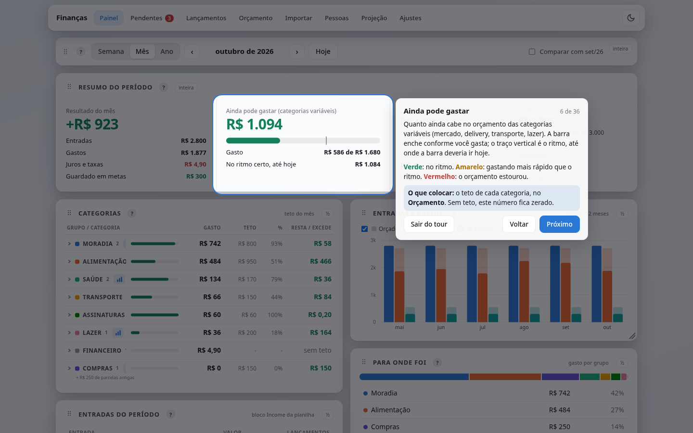

### As quatro ideias que explicam todo o resto

1. **Lançamento** é dinheiro entrando ou saindo de uma conta: a conta do Nubank, o cartão, o PicPay. Saída é
   negativa e entrada é positiva. No cartão, compra é negativa (vira dívida) e o pagamento da fatura é positivo.
2. Cada lançamento se divide em **partes**, e cada parte tem uma **natureza**:

   | natureza | o que é | entra no resultado? |
   |---|---|---|
   | gasto | consumo seu, com categoria (mercado, Uber) | sim, como gasto |
   | renda | dinheiro que é seu (salário, ajuda dos pais) | sim, como entrada |
   | transferência | entre contas suas (pagar a fatura com a conta) | não |
   | acerto | alguém te deve ou você deve a alguém | não, vai para Pessoas |
   | poupança | dinheiro seu indo para uma meta | não, vai para Metas |

3. **Pendente** é o lançamento que ainda não tem a classificação completa: um gasto sem categoria, um acerto
   sem pessoa. O sistema só classifica sozinho o que é certo por definição (o pagamento da fatura, um lugar
   conhecido como o Uber); o resto ele pergunta em **Pendentes**.
4. **Teto** é quanto você planeja gastar por mês numa categoria. É com ele que o Painel diz quanto ainda dá
   para gastar.

### A pessoa da demonstração

Para os números fazerem sentido: a pessoa da demonstração recebe R$ 2.600,00 de salário todo dia 5 e
R$ 200,00 de ajuda da mãe todo dia 14. Divide o apartamento com a Marina: o boleto do aluguel (R$ 1.300,00)
sai da conta dela no dia 6, metade é gasto dela e metade a Marina devolve por Pix. Usa a conta e o cartão do
Nubank (limite de R$ 3.000,00) e guarda R$ 300,00 por mês numa reserva de emergência. Os tetos das categorias
variáveis somam R$ 1.680,00 (mercado R$ 600, delivery R$ 250, lazer R$ 200, app de transporte R$ 150,
eletrônicos R$ 150, vestuário R$ 150, conveniência R$ 100, ônibus R$ 80).

## 2. O Painel, painel por painel

O Painel resume um período. Os painéis se arrastam pela alça (os seis pontinhos ao lado do título) e mudam de
largura no botão à direita do título; o **?** de cada um explica de novo.

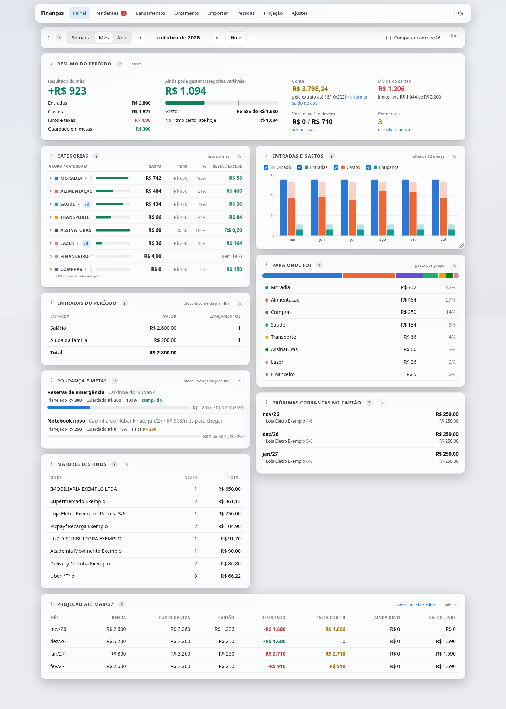

### Período

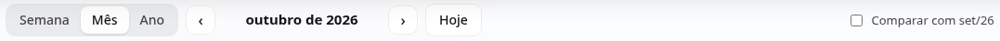

- **O que é**: qual pedaço do tempo o Painel mostra: uma **semana**, um **mês** ou um **ano**.
- **Como usar**: as setas vão para o período anterior ou o próximo; **Hoje** volta ao atual. **Comparar com
  set/26** liga, em cada número, a diferença para o período anterior (verde quando melhorou, vermelho quando
  piorou).
- **Detalhe que muda os números**: salário que cai do dia 25 em diante conta no mês seguinte (o salário do dia
  25 é para pagar o mês que vem). Na semana isso não vale.

### Resumo do período

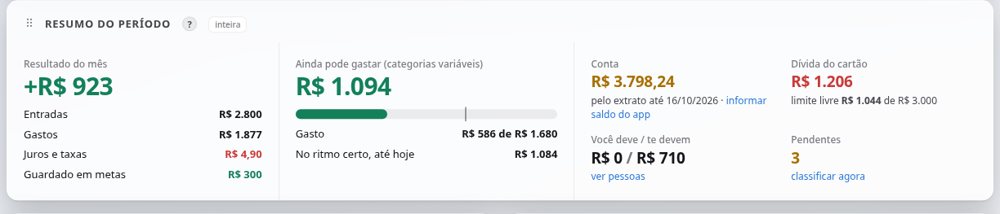

O painel mais importante. Na demonstração, em outubro até o dia 20:

- **Resultado do mês: +R$ 923**. É Entradas menos Gastos: R$ 2.800,00 − R$ 1.876,55 = R$ 923,45. Verde
  porque sobrou; fica vermelho quando os gastos passam das entradas.
  - **Entradas R$ 2.800** = salário R$ 2.600 + ajuda da mãe R$ 200.
  - **Gastos R$ 1.876** = R$ 1.776,55 já em categorias + R$ 100,00 de uma recarga do PicPay que ainda está
    pendente (o sistema já sabe que é gasto, falta dizer de quê).
  - **Juros e taxas R$ 4,90**: a parte dos gastos que foi taxa (aqui, a taxa de 4,9% da recarga do PicPay no
    crédito). Vermelho para chamar atenção: é dinheiro que não comprou nada.
  - **Guardado em metas R$ 300**: o que foi para a reserva de emergência no dia 6. Guardar não é gasto, por
    isso não entra no resultado.
  - O aluguel conta só R$ 650 (a metade da pessoa); os R$ 650 da Marina são acerto, não gasto.
- **Ainda pode gastar (categorias variáveis): R$ 1.094**. É a soma dos tetos das categorias variáveis menos o
  que já foi gasto nelas: R$ 1.680,00 − R$ 586,42 = R$ 1.093,58. Os R$ 586,42 são mercado R$ 361,13 +
  delivery R$ 105,30 + app de transporte R$ 66,22 + lazer R$ 35,84 + conveniência R$ 17,93. Categoria fixa
  (aluguel, academia, remédios, assinaturas, contas da casa) não entra aqui.
  - A **barra** está em 35% (R$ 586 de R$ 1.680) e o **traço vertical** em 65%: dia 20 de um mês de 31 dias.
    **No ritmo certo, até hoje: R$ 1.084** é 65% de R$ 1.680: quanto daria para ter gasto até hoje mantendo o
    ritmo. A barra está verde porque está abaixo do traço; fica amarela quando passa do ritmo e vermelha
    quando o orçamento estoura.
- **Conta: R$ 3.798,24**, em amarelo, "pelo extrato até 16/10/2026": é o saldo calculado pelos lançamentos,
  e o amarelo avisa que ainda não foi conferido com o saldo do app do banco. Tocando em **informar saldo do
  app** e digitando o saldo que o app do Nubank mostra, este número passa a ser o do banco, e a diferença vira
  "não lançados" (passo 9 da parte 4).
- **Dívida do cartão: R$ 1.206** (as compras de outubro no cartão; a fatura de setembro já foi paga no dia
  7). **Limite livre R$ 1.044 de R$ 3.000** = R$ 3.000 − R$ 1.206,25 da dívida − R$ 750,00 de parcelas que
  ainda vão cair (três de R$ 250 de uma compra parcelada). Fica vermelho abaixo de R$ 300.
- **Você deve / te devem: R$ 0 / R$ 710**: a Marina deve R$ 650 (a metade do aluguel de outubro, que ela
  ainda não devolveu) e o Téo deve R$ 60 (a metade de um jantar em setembro).
- **Pendentes: 3**, com o atalho **classificar agora**.

### Categorias

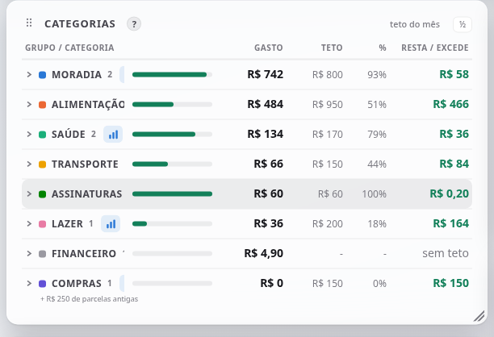

- **O que é**: cada categoria (ou grupo de categorias) contra o teto do período.
- **Como ler** cada linha: **Gasto**, **Teto**, **%** do teto e **Resta** (verde) ou **Excede** (vermelho,
  com o sinal +). A barra enche até o teto; vermelha quando passa.
  - **Alimentação: R$ 484 de R$ 950 (51%), resta R$ 466**. Abrindo o grupo (toque na linha): mercado R$ 361,13
    de R$ 600, delivery R$ 105,30 de R$ 250, conveniência R$ 17,93 de R$ 100.
  - **Moradia: R$ 742 de R$ 800 (93%)**: aluguel R$ 650 de R$ 650 + luz R$ 91,70 de R$ 150.
  - **Assinaturas: R$ 60 de R$ 60 (100%), resta R$ 0,20**: duas assinaturas de R$ 39,90 e R$ 19,90.
  - **Compras: R$ 0 de R$ 150, + R$ 250 de parcelas antigas**: a 3ª parcela de uma compra de eletrônicos.
    Parcela da 2ª em diante é compromisso antigo, não decisão deste mês: aparece à parte e não conta contra
    o teto.
  - **Financeiro: R$ 4,90, sem teto**: os juros e taxas.
- **No dia a dia**: o ícone de barras ao lado do grupo mostra a evolução dos últimos meses, com o teto
  tracejado e a média.

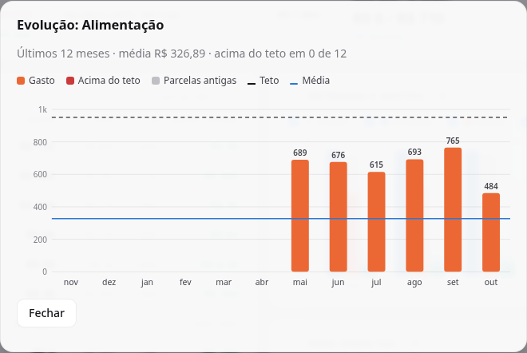

- **De onde vem**: das partes de gasto classificadas. O teto se define no **Orçamento**. Ordem,
  agrupamento e categorias sem gasto se mudam em **Ajustes > Visualização**.

### Entradas e gastos

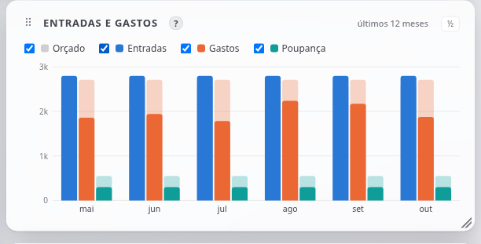

- **O que é**: entradas (azul), gastos (laranja) e poupança (verde-água) de cada um dos últimos 12 meses (ou
  12 semanas, ou janeiro a dezembro), com o **orçado** em tom claro atrás de cada barra.
- **Como ler**: barra de gasto passando da sombra clara é mês acima do orçamento. Toque numa coluna para ver os
  valores e o resultado do mês. As caixinhas em cima ligam e desligam cada série.
- **Na demonstração**: maio a setembro com entradas de R$ 2.800 e outubro ainda pela metade.

### Para onde foi

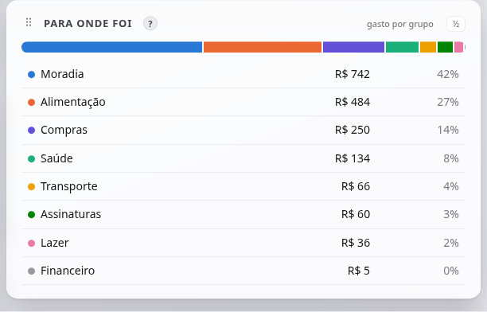

- **O que é**: a fatia de cada grupo no gasto do período, em valor e porcentagem.
- **Na demonstração**: Moradia R$ 742 (650 do aluguel + 91,70 da luz), Alimentação R$ 484, Compras R$ 250 (a
  parcela antiga entra aqui, porque o dinheiro saiu), Saúde R$ 134 (academia R$ 90 + remédios R$ 43,73),
  Transporte R$ 66, Assinaturas R$ 60, Lazer R$ 36 e Financeiro R$ 4,90. Somam R$ 1.776,55: os gastos do
  Resumo sem os R$ 100 do pendente, que ainda não tem grupo.

### Entradas do período

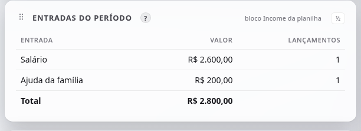

- **O que é**: o que entrou, por categoria de renda, com quantos lançamentos.
- **Na demonstração**: Salário R$ 2.600,00 e Ajuda dos pais R$ 200,00; total R$ 2.800,00, o mesmo de
  Entradas no Resumo.
- **De onde vem**: das partes classificadas como renda. Pix que você recebe de volta de um colega não é renda:
  é acerto, e vai para Pessoas.

### Poupança e metas

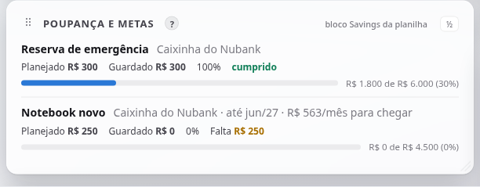

- **O que é**: cada meta de poupança, com o **planejado** no período, o **guardado**, a porcentagem e o que
  **falta**; embaixo, o total guardado contra o objetivo.
- **Na demonstração**:
  - **Reserva de emergência**: planejado R$ 300, guardado R$ 300 (100%), **cumprido**. Acumulado R$ 1.800 de
    R$ 6.000 (30%): seis aportes de R$ 300.
  - **Notebook novo**: planejado R$ 250, guardado R$ 0, **falta R$ 250**. R$ 0 de R$ 4.500, e "R$ 563/mês
    para chegar" até jun/27: R$ 4.500 divididos pelos 8 meses que faltam.
- **Como colocar dados**: a meta se cria no **Orçamento** (objetivo, prazo, aporte por mês). Guardar é um
  lançamento de **poupança** ligado à meta (passo 8 da parte 4). O aporte na caixinha do Nubank já chega
  como poupança; com mais de uma meta ativa, você diz qual.

### Próximas cobranças no cartão

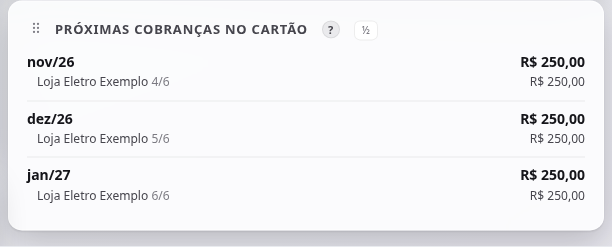

- **O que é**: parcelas que ainda vão cair no cartão, por mês da fatura.
- **Na demonstração**: a compra parcelada em 6 vezes de R$ 250 está na 3ª parcela; faltam a 4/6 em nov/26, a
  5/6 em dez/26 e a 6/6 em jan/27. São os R$ 750 descontados do limite livre.
- **De onde vem**: do número da parcela (3/6) que a fatura ou o celular trazem; a fatura em .csv também traz as
  parcelas futuras (passo 5).

### Maiores destinos

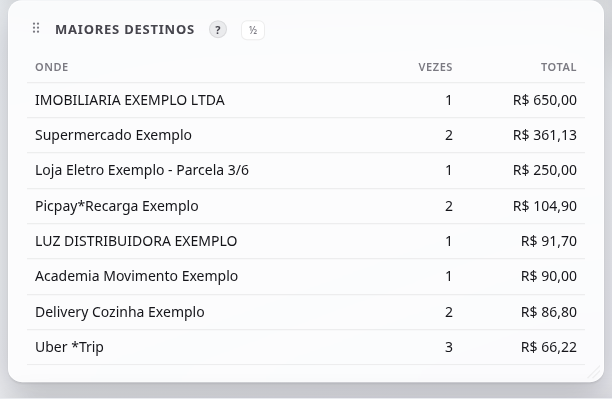

- **O que é**: onde mais saiu dinheiro em gastos no período, somado por lugar ou pessoa, com quantas vezes.
- **Na demonstração**: a imobiliária (R$ 650, a parte da pessoa), o supermercado (2 vezes, R$ 361,13), a
  parcela dos eletrônicos (R$ 250), a recarga do PicPay (R$ 104,90 em duas partes: a taxa e o principal) e a
  luz (R$ 91,70).

### Projeção

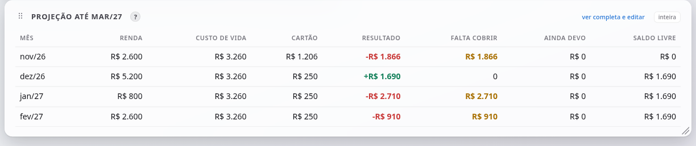

- **O que é**: os próximos 4 meses da aba **Projeção**.
- **Como ler**, em nov/26 na demonstração:
  - **Renda R$ 2.600**: o salário base do Orçamento.
  - **Custo de vida R$ 3.260** = R$ 2.710 dos tetos de todas as categorias de gasto + R$ 550 de aportes nas
    metas (R$ 300 + R$ 250).
  - **Cartão R$ 1.206**: a dívida atual do cartão vence no primeiro mês.
  - **Resultado −R$ 1.866** = 2.600 − 3.260 − 1.206. **Falta cobrir R$ 1.866**, em amarelo: é o que teria de
    vir de algum lugar (o saldo da conta, por exemplo).
  - Em **dez/26** a renda é R$ 5.200 (salário + 13º, um evento da Projeção) e o resultado fica +R$ 1.690, que
    vira **saldo livre**. Em **jan/27** a renda cai para R$ 800 (R$ 2.600 − R$ 1.800 da viagem).
- **O que esses números dizem**: os tetos somam R$ 2.710, mais que o salário. A projeção avisa antes: ou os
  tetos baixam no Orçamento, ou a ajuda da mãe (R$ 200) entra no Orçamento como renda prevista.

## 3. As outras telas

### Pendentes


- **O que é**: o que o sistema não classifica sozinho. Na demonstração, três:
  - **Picpay\*Recarga Exemplo, R$ 100,00**: a recarga do PicPay no cartão já teve a taxa separada ("já
    separado: taxa PicPay no crédito (4,90%) −R$ 4,90"); o principal pode ser pagamento da fatura por fora,
    pagamento a alguém ou compra, e só você sabe.
  - **Loja Nova Exemplo, R$ 89,90**: compra que veio "pelo celular" num lugar que o sistema não conhece.
  - **TEO FICTICIO, R$ 30,00**: um Pix para o Téo. Pix com pessoa nunca é classificado sozinho (o mesmo Pix
    pode ter outra finalidade); vem com a **Sugestão: acerto Téo** em azul.
- **Como usar**: um toque numa categoria (ou na sugestão) classifica e o item some da lista. **outras...**
  mostra as demais categorias. **Dividir...** separa em partes: a sua parte como gasto e a de um colega como
  acerto, por exemplo. Com **sugerir a mesma classificação da próxima vez** marcado, o mesmo lugar já chega
  com a sugestão (nunca classificado sozinho).

### Lançamentos

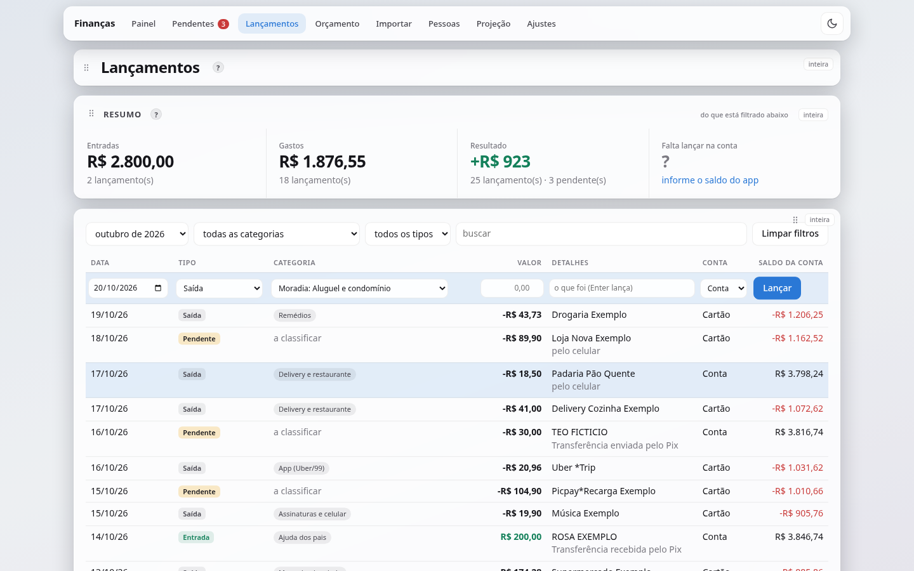

- **Resumo**: entradas, gastos e resultado do que está filtrado, e **Falta lançar na conta** (a diferença para
  o saldo do app do banco, a mesma do Painel). O mês daqui conta pela data de cada lançamento; o Painel conta
  o salário do dia 25 em diante no mês seguinte, por isso os dois podem diferir.
- **Filtros**: mês, categoria, tipo (entrada, saída, transferência, acerto, dividido, estorno, poupança,
  pendente) e busca pelo nome.
- **A primeira linha da tabela lança à mão**: data, tipo (saída, entrada, guardar em meta, resgatar de meta,
  acerto paguei, acerto recebi, transferência), a categoria ou a pessoa, o valor, o que foi e a conta. Enter
  lança (passo 1).
- **A tabela**: um toque num lançamento abre o editor (mudar a categoria, dividir em partes, escrever uma
  observação, apagar). Só se apaga o que foi lançado à mão ou pelo celular: o do extrato é a fonte. A última
  coluna é o saldo da conta logo depois de cada lançamento.

### Orçamento

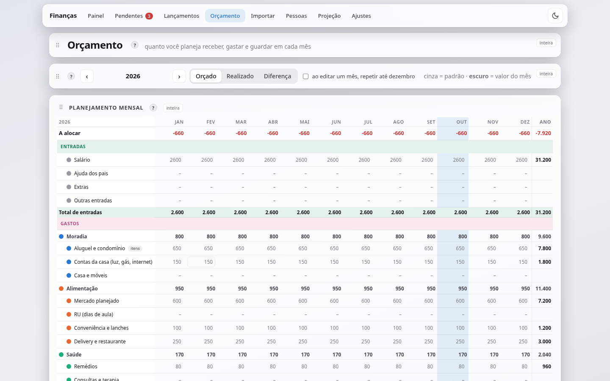

- **A grade**: cada categoria e cada meta em cada mês do ano. Em cinza fica o padrão (o teto da categoria, o
  salário base, o aporte da meta, ou a soma das despesas fixas). Digitar numa célula muda só aquele mês;
  **repetir até dezembro** vale também para os seguintes; apagar a célula volta ao padrão. Os modos
  **Realizado** e **Diferença** mostram o que aconteceu e o quanto ficou a favor (positivo) ou contra.
- **Despesas fixas**: os itens que se pagam todo mês. Na demonstração, Aluguel e condomínio usa a soma dos
  itens como orçamento: "Aluguel (minha metade)" R$ 600 + "Condomínio (minha metade)" R$ 50 = R$ 650.
- **Categorias**: grupo, nome, teto mensal e se é **fixa**. Fixa não entra no "ainda pode gastar". Ao apagar
  uma categoria com lançamentos, você escolhe para qual eles vão.
- **Metas**: nome, objetivo, prazo, aporte mensal e onde o dinheiro fica.

### Importar

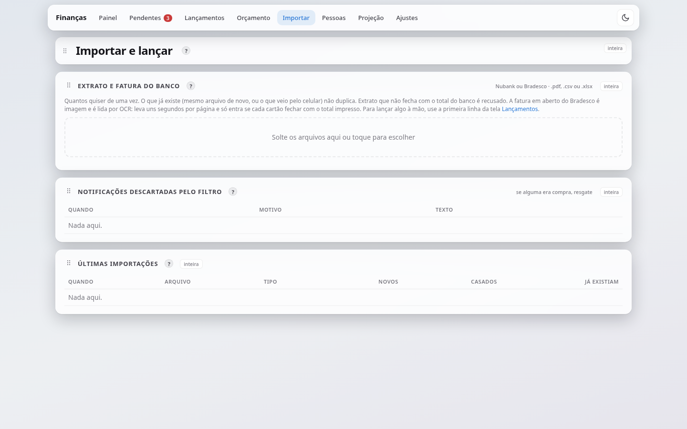

- **Extrato e fatura do banco**: solte os arquivos (ou toque para escolher). O tipo é reconhecido pelo
  conteúdo, não pelo nome. Detalhes de cada formato na [parte 5](#5-como-os-dados-entram).
- **Notificações descartadas pelo filtro**: o que chegou do celular e não era compra (aviso de fatura,
  propaganda, código de segurança). Se alguma era compra, **resgatar** a transforma em lançamento.
- **Últimas importações**: quantos lançamentos novos, quantos casaram com o que veio pelo celular e quantos já
  existiam (passo 3).

### Pessoas

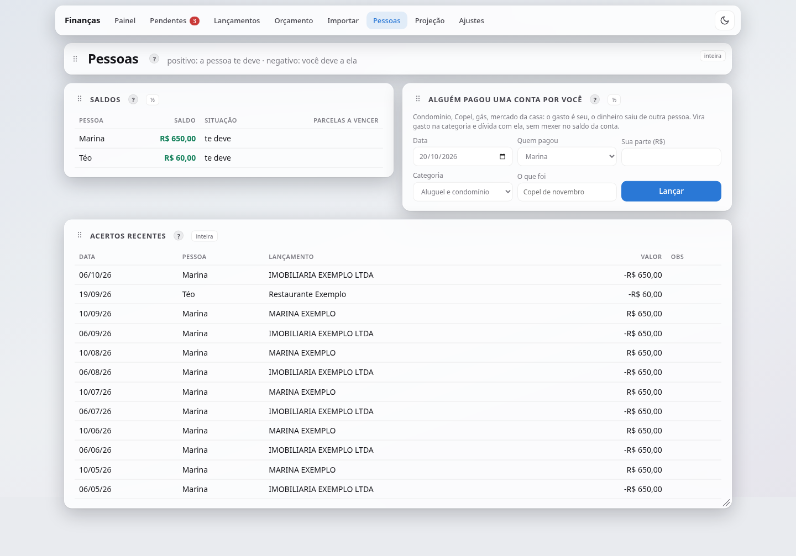

- **Saldos**: positivo, a pessoa te deve; negativo, você deve a ela. Na demonstração, Marina +R$ 650,00 e Téo
  +R$ 60,00. **Parcelas a vencer** são parcelas futuras que alguém te deve.
- **Alguém pagou uma conta por você**: quando outra pessoa paga uma conta sua (a luz, o mercado da casa). O
  gasto entra na categoria e vira dívida com ela, sem mexer no saldo da sua conta.
- **Acertos recentes**: os últimos Pix de acerto, mandados ou recebidos.

### Projeção

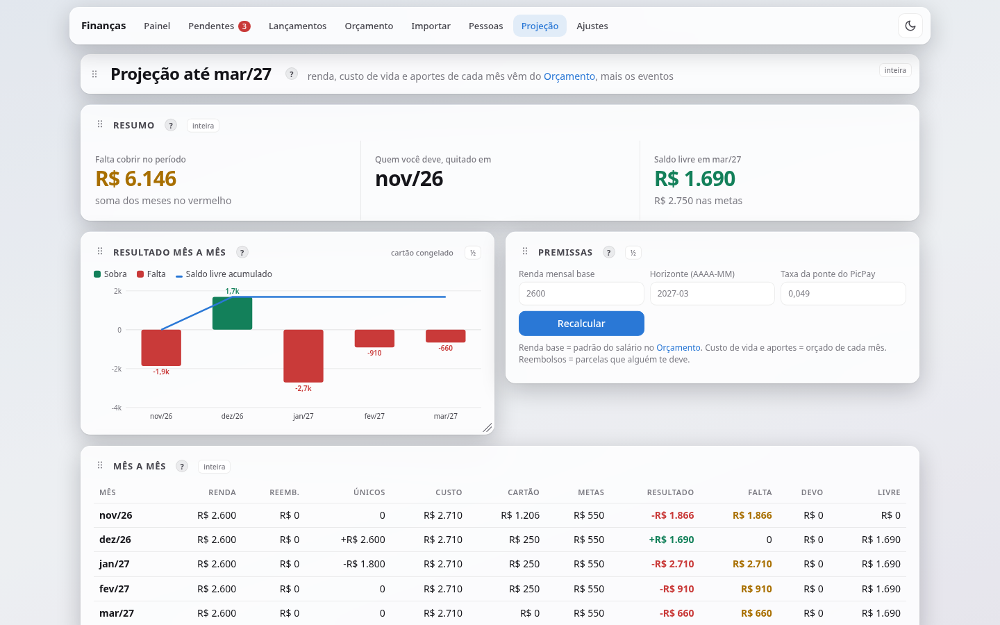

- **Resumo e gráfico**: **Falta cobrir** soma os meses no vermelho; **Saldo livre** é o que sobra no fim do
  horizonte depois de pagar quem você deve. No gráfico, cada barra é o resultado do mês (verde sobra, vermelho
  falta) e a linha azul é o saldo livre acumulado.
- **Premissas**: renda mensal base, até quando projetar (o horizonte, AAAA-MM) e a taxa do PicPay.
- **Tabela**: os números de cada mês, os mesmos explicados na [Projeção do Painel](#projeção).
- **Eventos**: o que muda e quando. Na demonstração, "13º salário" (entrada única de R$ 2.600 em dez/26) e
  "Viagem de janeiro" (saída única de R$ 1.800 em jan/27). Também dá para cadastrar renda ou gasto mensal
  que muda a partir de um mês (passo 10).

### Ajustes

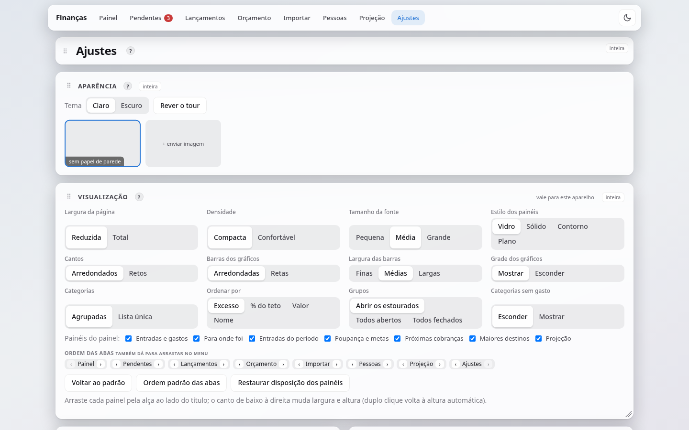

- **Aparência**: tema claro ou escuro, papel de parede e **Rever o tour**.
- **Visualização** (vale só para este aparelho): largura, densidade, fonte, estilo dos painéis, como as
  categorias aparecem, quais painéis mostrar e a ordem das abas.
- **Pessoas**: nome, como o nome aparece no extrato (para o Pix ser reconhecido) e o que sugerir quando
  entra ou sai dinheiro da pessoa. Na demonstração, "MARINA EXEMPLO", "TEO FICTICIO" e "ROSA EXEMPLO" (a mãe,
  que sugere renda).
- **Rateio do aluguel**: quanto do boleto da imobiliária é de cada um (aqui, 50% e 50%).
- **Celular**: no computador, o endereço do servidor e a chave para copiar no app (e os campos do MacroDroid);
  no app, os ajustes do celular ([parte 6](#6-o-app-do-celular-android)).
- **Planilha e sessão**: **Baixar tabelas (.xlsx)**, com uma aba por tabela. O modelo antigo (.ods) precisa do
  LibreOffice: no Windows e no celular o botão fica desabilitado com o motivo.

O tema escuro, em Aparência:

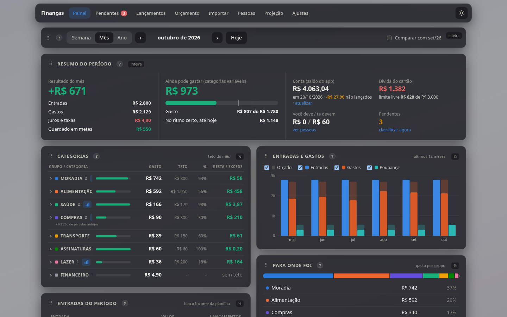

## 4. Passo a passo: cada ação e o número que ela muda

As dez ações abaixo foram feitas nesta ordem, na demonstração. Cada uma parte do estado deixado pela anterior.

### Passo 1. Lançar um gasto à mão

**Ação**: em **Lançamentos**, na primeira linha da tabela: data 20/10/2026, tipo Saída, categoria **Mercado
planejado**, valor **45,00**, "Feira do bairro", conta Conta. Enter.

| número | antes | depois | por quê |
|---|---|---|---|
| Ainda pode gastar | R$ 1.093,58 | R$ 1.048,58 | mercado é variável: −R$ 45,00 |
| Mercado (Categorias) | R$ 361,13 | R$ 406,13 | +R$ 45,00, 3 lançamentos |
| Gastos (Resumo) | R$ 1.876,55 | R$ 1.921,55 | +R$ 45,00 |
| Resultado do mês | +R$ 923,45 | +R$ 878,45 | −R$ 45,00 |
| Conta | R$ 3.798,24 | R$ 3.753,24 | o dinheiro saiu da conta |

Antes e depois no Resumo:


E o lançamento na tabela, com o saldo da conta logo depois dele:

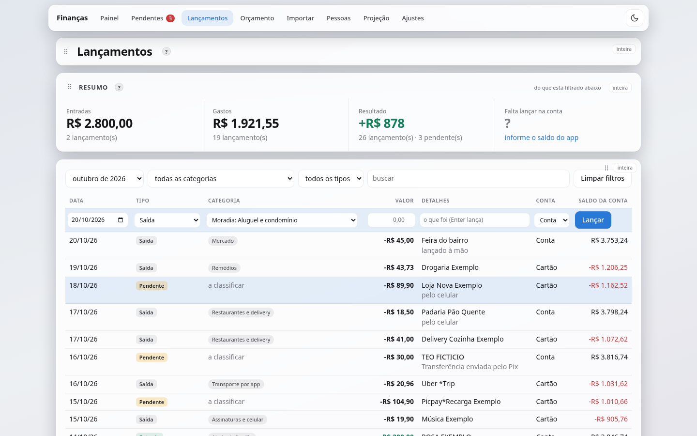

### Passo 2. Classificar um pendente

**Ação**: em **Pendentes**, na compra **Loja Nova Exemplo** (R$ 89,90, no cartão), tocar em **outras...** e
escolher **Vestuário e imagem**, com "sugerir a mesma classificação da próxima vez" marcado.

| número | antes | depois | por quê |
|---|---|---|---|
| Pendentes | 3 | 2 | a compra saiu da lista |
| Vestuário (Categorias) | R$ 0,00 | R$ 89,90 | a compra agora tem categoria |
| Ainda pode gastar | R$ 1.048,58 | R$ 958,68 | vestuário é variável: −R$ 89,90 |
| Gastos (Resumo) | R$ 1.921,55 | R$ 2.011,45 | +R$ 89,90 |
| Resultado do mês | +R$ 878,45 | +R$ 788,55 | −R$ 89,90 |
| Conta | R$ 3.753,24 | R$ 3.753,24 | não muda: a compra foi no cartão |

Antes de classificar, a compra já existia e já estava na dívida do cartão, mas não contava em gasto nenhum,
porque não tinha categoria. Classificar é o que a leva para os números do mês. Com "sugerir da próxima vez",
a próxima compra na Loja Nova Exemplo chega com a sugestão Vestuário.


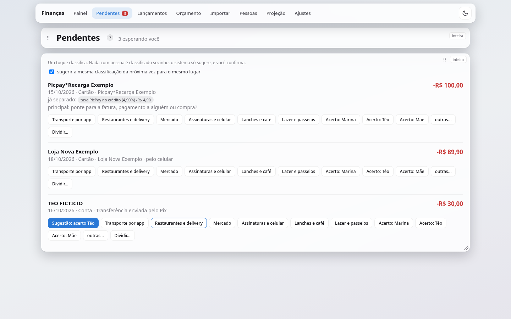

### Passo 3. Importar o extrato da conta (.csv)

**Ação**: em **Importar**, soltar o extrato da conta em .csv (o arquivo que o app do Nubank exporta) com três
linhas:

```
Data,Valor,Identificador,Descrição
17/10/2026,-18.50,...,Compra no débito - PADARIA PAO QUENTE
18/10/2026,-62.30,...,Compra no débito - SUPERMERCADO EXEMPLO
19/10/2026,650.00,...,Transferência recebida pelo Pix - MARINA EXEMPLO - •••.111.222-•• - BCO EXEMPLO
```

**Resultado da importação**: 2 novos, 1 casado, 0 já existiam.

- A padaria de R$ 18,50 já tinha chegado pelo celular no dia 17: o arquivo só **casou** com ela (confirmou e
  detalhou) e não duplicou.
- O supermercado (R$ 62,30) é novo e caiu sozinho em **Mercado planejado**, porque "SUPERMERCADO" é um lugar
  conhecido.
- O Pix da Marina (R$ 650,00) é novo e vai para **Pendentes**, com a sugestão "acerto com Marina (confira)",
  porque o nome bate com o cadastro dela em Ajustes.

| número | antes | depois | por quê |
|---|---|---|---|
| Mercado (Categorias) | R$ 406,13 | R$ 468,43 | +R$ 62,30 do supermercado |
| Ainda pode gastar | R$ 958,68 | R$ 896,38 | −R$ 62,30 |
| Resultado do mês | +R$ 788,55 | +R$ 726,25 | −R$ 62,30 (o Pix é acerto, não renda) |
| Conta | R$ 3.753,24 | R$ 4.340,94 | +R$ 650,00 − R$ 62,30; a padaria já estava |
| Pendentes | 2 | 3 | o Pix da Marina espera você |
| Conta "pelo extrato até" | 16/10/2026 | 19/10/2026 | o arquivo cobre até o dia 19 |

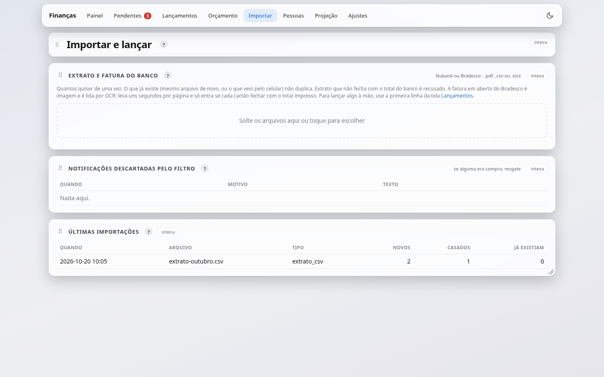

### Passo 4. Classificar o Pix da Marina como acerto

**Ação**: em **Pendentes**, no Pix de R$ 650,00 da Marina, tocar na sugestão **acerto Marina**.

| número | antes | depois | por quê |
|---|---|---|---|
| Marina (Pessoas) | +R$ 650,00 | R$ 0,00 | ela devolveu a metade do aluguel |
| Te devem (Resumo) | R$ 710 | R$ 60 | sobra só o Téo |
| Pendentes | 3 | 2 | |
| Resultado do mês | +R$ 726,25 | +R$ 726,25 | não muda: acerto não é renda |

Os R$ 650,00 entraram na conta (passo 3), mas não são dinheiro seu: são a parte da Marina no boleto que você
pagou. Por isso o resultado não muda e o saldo dela zera.


### Passo 5. Importar a fatura do cartão (.csv)

**Ação**: em **Importar**, soltar a fatura em .csv (o arquivo que o app do Nubank exporta) com uma corrida de
Uber de R$ 23,10 e uma compra parcelada em 3 vezes de R$ 120,00 (a 1ª parcela agora, a 2ª e a 3ª nos meses
seguintes):

```
date,title,amount
2026-10-19,Uber *Trip,23.10
2026-10-19,Loja Casa Exemplo - Parcela 1/3,120.00
2026-11-19,Loja Casa Exemplo - Parcela 2/3,120.00
2026-12-19,Loja Casa Exemplo - Parcela 3/3,120.00
```

**Resultado da importação**: 2 novos e 2 parcelas futuras.

| número | antes | depois | por quê |
|---|---|---|---|
| App (Uber/99) | R$ 66,22 | R$ 89,32 | o Uber caiu sozinho na categoria |
| Ainda pode gastar | R$ 896,38 | R$ 873,28 | −R$ 23,10 |
| Resultado do mês | +R$ 726,25 | +R$ 703,15 | −R$ 23,10 (a parcela ainda é pendente) |
| Dívida do cartão | R$ 1.206,25 | R$ 1.349,35 | +R$ 23,10 + R$ 120,00 |
| Parcelas futuras | R$ 750,00 | R$ 990,00 | +R$ 120,00 em nov e +R$ 120,00 em dez |
| Limite livre | R$ 1.043,75 | R$ 660,65 | 3.000 − 1.349,35 − 990,00 |
| Pendentes | 2 | 3 | a Loja Casa Exemplo é lugar novo |
| Projeção: resultado de dez/26 | +R$ 1.690 | +R$ 1.570 | a 2/3 cai na fatura que vence em dezembro |

As **Próximas cobranças** ganham a Loja Casa Exemplo em nov/26 e dez/26:

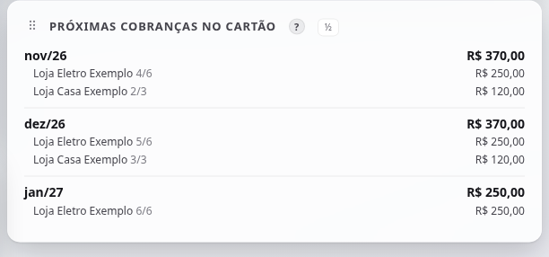

### Passo 6. Uma compra que chega pelo celular

**Ação**: o banco manda a notificação "Compra de R$ 32,40 aprovada em Drogasil no cartão final 1234", e o
celular a entrega (pelo app Finanças, que aplica no próprio celular na hora, ou pelo MacroDroid, que manda ao
servidor).

| número | antes | depois | por quê |
|---|---|---|---|
| Remédios (Categorias) | R$ 43,73 | R$ 76,13 | Drogasil é farmácia conhecida: classificado sozinho |
| Dívida do cartão | R$ 1.349,35 | R$ 1.381,75 | "no cartão": a compra entra na conta do cartão |
| Limite livre | R$ 660,65 | R$ 628,25 | −R$ 32,40 |
| Resultado do mês | +R$ 703,15 | +R$ 670,75 | −R$ 32,40 |
| Ainda pode gastar | R$ 873,28 | R$ 873,28 | não muda: Remédios é categoria fixa |
| Pendentes | 3 | 3 | não muda: lugar conhecido não vira pendente |

Quando o extrato ou a fatura chegarem, essa compra casa com a linha do arquivo, como a padaria no passo 3.

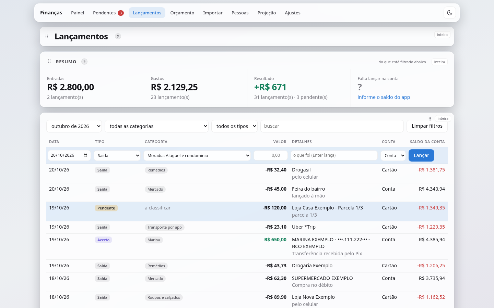

### Passo 7. Mudar o orçamento de um mês

**Ação**: em **Orçamento**, na linha **Mercado planejado**, coluna de outubro, digitar **700** (o padrão era o
teto de R$ 600) e Enter, sem "repetir até dezembro".

| número | antes | depois | por quê |
|---|---|---|---|
| Teto de Mercado em outubro | R$ 600 | R$ 700 | só outubro; novembro continua R$ 600 |
| Tetos variáveis (Resumo) | R$ 1.680,00 | R$ 1.780,00 | +R$ 100,00 |
| Ainda pode gastar | R$ 873,28 | R$ 973,28 | +R$ 100,00 |

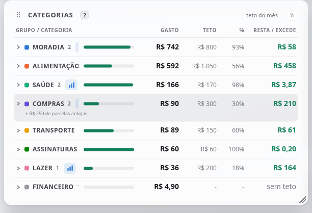
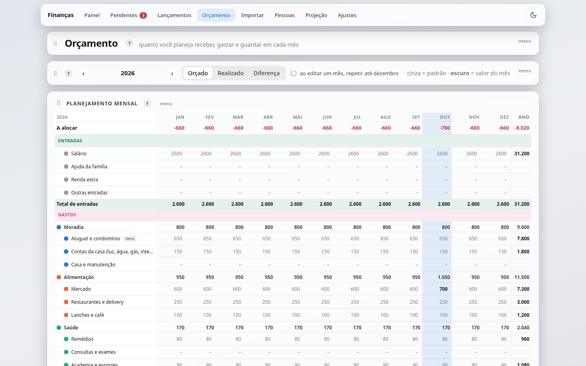

### Passo 8. Guardar dinheiro numa meta

**Ação**: em **Lançamentos**, na primeira linha: tipo **Guardar em meta**, meta **Notebook novo**, valor
**250,00**, "Dinheiro guardado", conta Conta.

| número | antes | depois | por quê |
|---|---|---|---|
| Notebook novo: guardado no mês | R$ 0 | R$ 250 | o aporte foi para a meta |
| Notebook novo: falta no mês | R$ 250 | cumprido | planejado R$ 250, guardado R$ 250 |
| Notebook novo: acumulado | R$ 0 de R$ 4.500 | R$ 250 de R$ 4.500 (6%) | |
| Notebook novo: por mês até o prazo | R$ 563 | R$ 531 | (4.500 − 250) ÷ 8 meses |
| Guardado em metas (Resumo) | R$ 300 | R$ 550 | 300 da reserva + 250 do notebook |
| Conta | R$ 4.340,94 | R$ 4.090,94 | o dinheiro saiu da conta (para a caixinha) |
| Resultado do mês e Ainda pode gastar | iguais | iguais | guardar não é gastar |

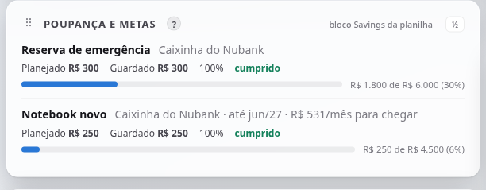

### Passo 9. Informar o saldo do app do banco

**Ação**: no Resumo, tocar em **informar saldo do app** e digitar **4063,04**, o saldo que o app do Nubank
mostra. Há R$ 27,90 a menos que o calculado: um café no débito que ainda não chegou nem pelo celular nem por
arquivo.

| número | antes | depois | por quê |
|---|---|---|---|
| Conta | R$ 4.090,94 (calculado, amarelo) | R$ 4.063,04 (saldo do app) | o saldo do banco é a verdade |
| Diferença | (sem) | −R$ 27,90 não lançados | gasto que o banco já mostra e ainda não entrou aqui |

O "não lançados" some quando o extrato traz o café (ou quando você o lança à mão). Ele aparece também em
**Lançamentos > Falta lançar na conta**.

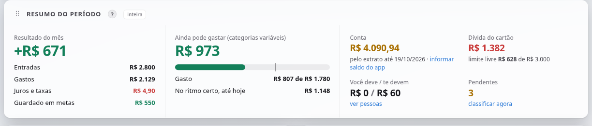

### Passo 10. Cadastrar um evento na Projeção

**Ação**: em **Projeção > Eventos**, "Freela de dezembro", tipo **entrada única**, início 2026-12, valor
**800**.

| número | antes | depois | por quê |
|---|---|---|---|
| Resultado de dez/26 | +R$ 1.570 | +R$ 2.370 | +R$ 800 do freela |
| Saldo livre de dez/26 em diante | R$ 1.570 | R$ 2.370 | a sobra de dezembro acumula |
| Falta cobrir (total) | R$ 6.441,75 | R$ 6.441,75 | não muda: os meses no vermelho são outros |

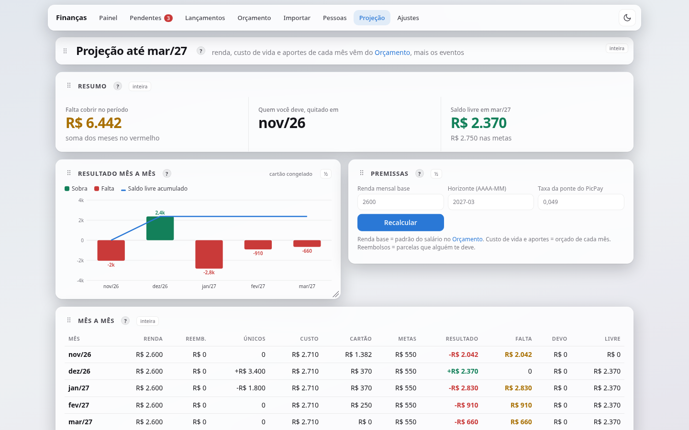

### Onde a demonstração terminou

Depois dos dez passos, outubro fecha (até o dia 20) com entradas de R$ 2.800,00, gastos de R$ 2.129,25 e
resultado de +R$ 670,75; ainda pode gastar R$ 973,28; dívida do cartão R$ 1.381,75 com R$ 628,25 de limite
livre; e 3 pendentes (a recarga do PicPay, o Pix para o Téo e a Loja Casa Exemplo).

## 5. Como os dados entram

| de onde | como | o que acontece |
|---|---|---|
| Extrato da conta do Nubank | .pdf ou .csv, em Importar | entra conferido pelo total do banco; o que já existe não duplica |
| Fatura do cartão do Nubank | .pdf ou .csv, em Importar | as parcelas futuras vão para as Próximas cobranças |
| Extrato do Bradesco | .pdf, .csv ou .xlsx, em Importar | conferido pelo total e pela corrente de saldos; a conta Bradesco nasce na 1ª importação |
| Fatura em aberto do Bradesco | o .pdf que o app do Bradesco gera, em Importar | é imagem, lida por OCR (alguns segundos por página); só entra se cada cartão fechar com o "Total para" impresso |
| Compra no dia a dia | a notificação do banco, pelo app Finanças ou pelo MacroDroid | entra na hora; lugar conhecido já vem classificado, o resto vai para Pendentes |
| O que não passa pelo banco | a primeira linha de Lançamentos | dinheiro vivo, conta paga por outra pessoa, acerto, aporte em meta |

Extrato que não fecha com o próprio total é recusado inteiro (sinal de linha perdida no arquivo). No celular,
.pdf não é lido: importe o .csv ou o .xlsx, ou importe o .pdf no computador, que ele chega ao celular na
sincronização.

Um ritmo que funciona: deixar o celular mandar as compras, classificar os pendentes quando aparecerem, e uma
vez por mês importar o extrato e a fatura e informar o saldo do app.

## 6. O app do celular (Android)

O app Finanças é o site inteiro dentro do celular, com o banco de dados no próprio aparelho: abre, lista,
lança e classifica sem servidor e sem internet. Ele também faz o papel do MacroDroid: lê as notificações dos
apps de banco e lança na hora.

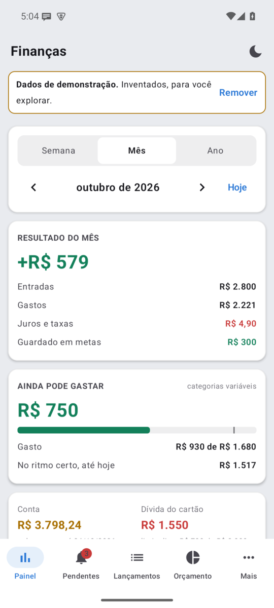

### Instalar

1. Copie o arquivo `financas-<versão>.apk` para o celular e abra. O Android pergunta se permite instalar apps
   dessa origem (o navegador ou o gerenciador de arquivos): permita.
2. Abra o **Finanças**. O tour passa por cada tela, como no computador.


### Dar acesso às notificações

Em **Ajustes > Celular**, toque em **Acesso a notificações** e ligue o **Finanças** na tela do Android. A
linha "Acesso a notificações" passa a mostrar **liberado**. Sem isso, as compras não entram sozinhas.

Os apps lidos ficam em **Apps monitorados**: Nubank, PicPay, Mercado Pago e Bradesco já vêm marcados; outro
banco entra em **Outros apps**, pelo nome do pacote. Para o Android não fechar o app em segundo plano:
Configurações > Apps > Finanças > Bateria > **Sem restrições**.

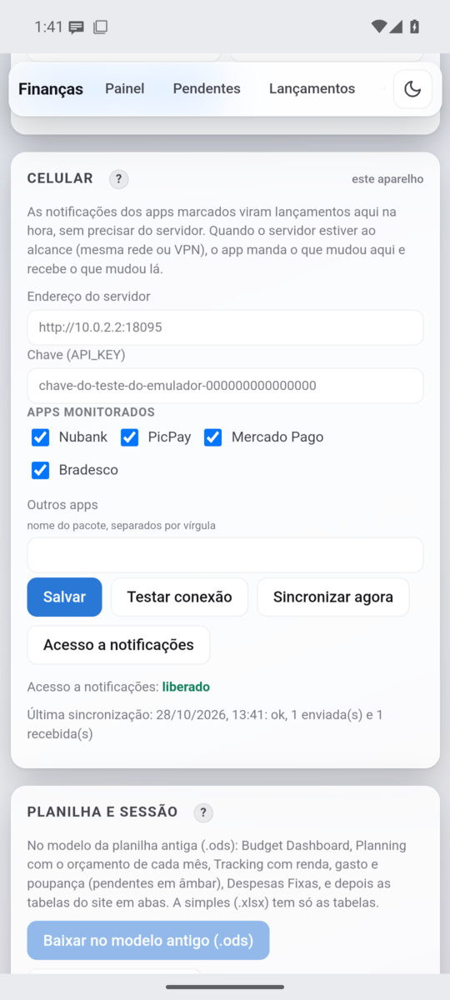

Os prints do app são do emulador usado no teste: o endereço `http://10.0.2.2:18095` é como o emulador enxerga o
computador. No seu celular, use o endereço que aparece em Ajustes no computador.

### Ligar ao Finanças do computador (opcional)

1. No computador, abra **Ajustes > Celular** e veja o **Endereço do servidor** (por exemplo
   `http://192.168.0.10:8095`) e a **Chave**. Para não digitar a chave, abra o site no navegador do celular e use
   o botão **copiar**.
2. No app, em **Ajustes > Celular**, preencha **Endereço do servidor** e **Chave** e toque em **Salvar**.
3. **Testar conexão** diz se o servidor respondeu e se a chave foi aceita.

Para o computador aceitar o celular, a instalação no Windows precisa da opção "Permitir que o celular acesse
pela rede local". Fora de casa, use o Tailscale (veja o [README](../README.md#acesso-de-fora-de-casa-tailscale)).

### O que funciona sem servidor e o que muda quando ele aparece

- **Sem servidor** (sem internet, fora de casa, computador desligado): tudo. A compra notificada vira
  lançamento na hora, na ordem em que chegou, com a mesma leitura e a mesma classificação do servidor; você
  classifica, lança à mão, mexe no orçamento e importa .csv e .xlsx, tudo no celular.
- **Quando o servidor fica ao alcance**: o app sincroniza sozinho, a cada 15 minutos, ao abrir e ao sair do
  app e depois de cada compra (ou na hora, em **Sincronizar agora**). Ele manda o que mudou no celular e
  recebe o que mudou no computador: o extrato que você importou no PC aparece no celular, e o pendente que você
  classificou no celular aparece classificado no PC. A linha **Última sincronização** mostra quando foi e
  quantas mudanças foram e vieram.
- **Se os dois mudarem a mesma coisa** antes de sincronizar, vale a alteração mais recente, registro por
  registro (um lançamento com as partes, uma categoria, uma meta).
- A mesma compra não entra duas vezes: o extrato importado no computador casa com a compra que o celular viu.
  Só não use o app e o MacroDroid ao mesmo tempo no mesmo celular.

## 7. Dúvidas comuns

**O resultado do mês não bate com o quanto o saldo da conta mudou.** Normal: transferência entre contas suas
(pagar a fatura), acerto com pessoas (o Pix da Marina) e dinheiro guardado em meta mexem no saldo, mas não são
renda nem gasto seu. No passo 3 a conta subiu R$ 587,70 e o resultado caiu R$ 62,30.

**Um gasto sumiu dos números.** Veja se ele está em **Pendentes**: gasto sem categoria entra na dívida do
cartão e no saldo, mas não nas categorias (passo 2).

**Lancei algo errado.** Em **Lançamentos**, toque nele: dá para mudar a classificação ou apagar (o que veio de
extrato não se apaga, porque o arquivo é a fonte; mude a classificação).

**Quero ver o tour de novo.** **Ajustes > Aparência > Rever o tour**.

**Esqueci a senha do site (Windows).** Ela fica no arquivo `.env` da pasta `%LOCALAPPDATA%\Financas`, na linha
`WEB_PASSWORD`. Para trocar, reinstale com a nova senha (os dados ficam).
